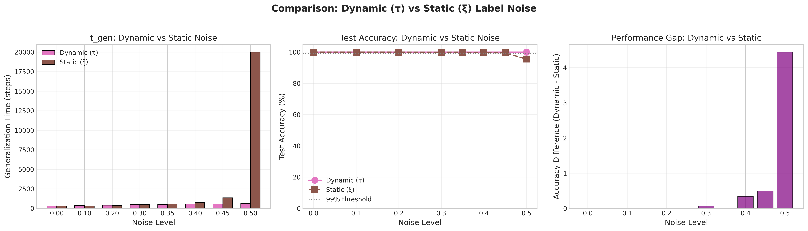
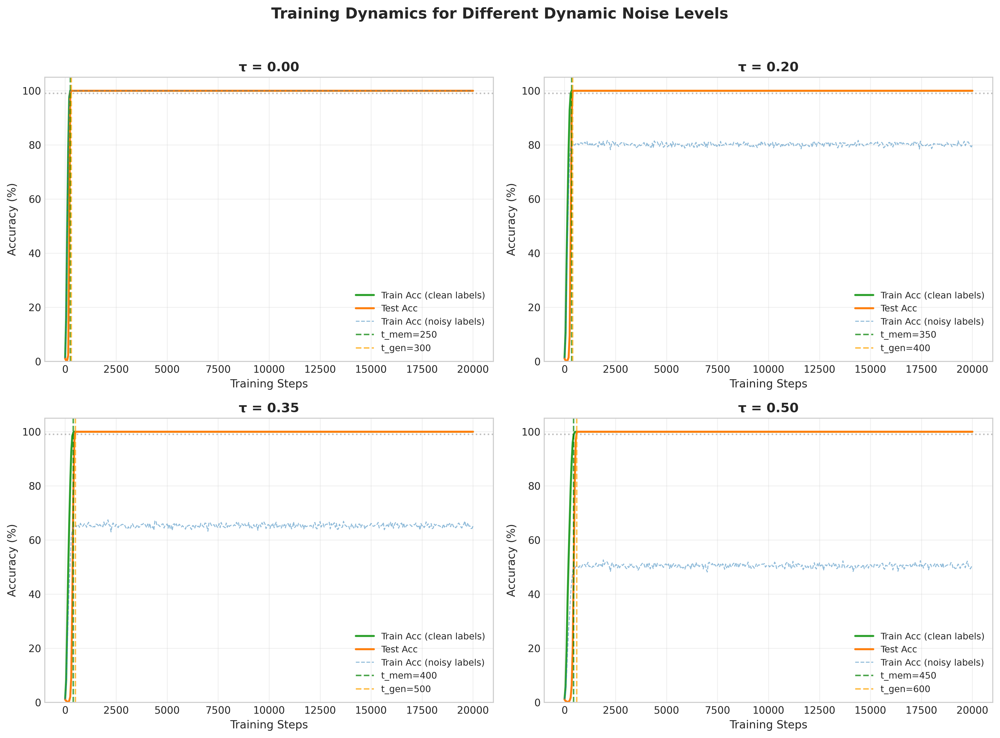
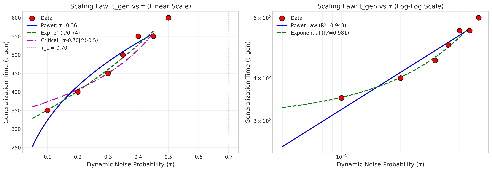
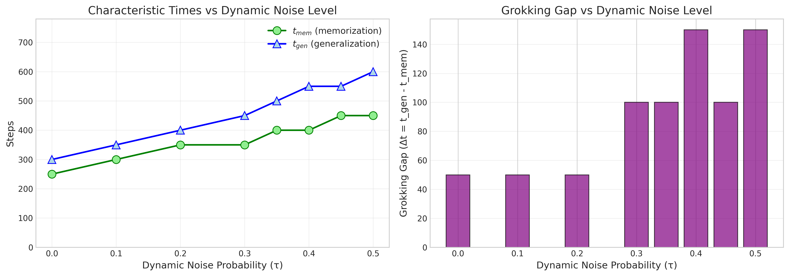
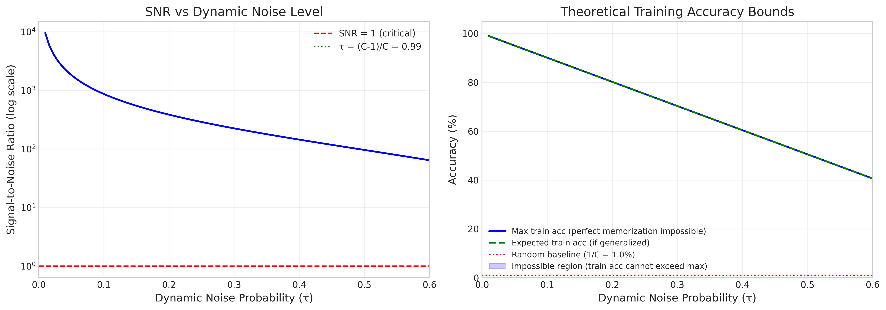
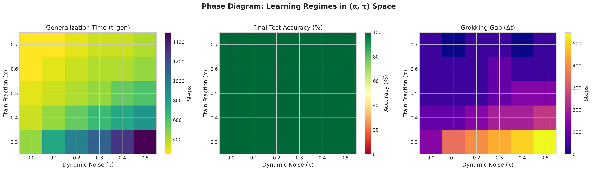

# 🔬 Grokking with Dynamic Label Corruption (τ)

[](.)
[](https://www.kaggle.com/code/balbinotchoutzine/t-grokk)
[](LICENSE)

> **A Systematic Study of Non-Stationary Noise Effects on Delayed Generalization**

**Authors:** Balbino Tchoutzine (supervised by Pascal Tikeng)

---

## 📌 Key Finding

**Dynamic label noise is paradoxically beneficial for grokking!**

| Noise Level | Dynamic (τ) | Static (ξ) | Improvement |
|-------------|-------------|------------|-------------|
| **50%** | 100% test acc, 600 steps | 95.6% test acc, fails | **+4.4% acc, 33× faster** |

---

##  Abstract

Previous studies of grokking under label noise focused on *static* corruption (labels corrupted once before training). We introduce **dynamic label corruption**, where each label is randomly corrupted with probability τ **at each training step**. 

Unlike static noise, dynamic noise is **fundamentally non-memorizable** since corrupted labels change every iteration. Our experiments reveal that dynamic noise acts as **implicit regularization**, forcing models to learn the algorithmic structure rather than memorize individual labels.

---

## Static vs Dynamic Noise

```
STATIC NOISE (ξ):                      DYNAMIC NOISE (τ):
──────────────────                     ──────────────────
Labels corrupted ONCE                  Labels corrupted EVERY STEP
before training                        during training

Epoch 1: [3, 4, 2, 5, 9, 8]           Step 1: [3, 4, 2, 5, 1, 8]
Epoch 2: [3, 4, 2, 5, 9, 8] ← same    Step 2: [3, 7, 9, 5, 1, 0] ← different!
Epoch 3: [3, 4, 2, 5, 9, 8] ← same    Step 3: [1, 7, 2, 5, 6, 8] ← different!

→ Memorizable                          → NON-memorizable
```

---

## 📊 Main Results

### 1. Dynamic vs Static Comparison



*At 50% noise, dynamic corruption achieves perfect generalization while static corruption fails completely.*

---

### 2. Training Dynamics



*The model learns the true function (green/orange at 100%) while training accuracy on noisy labels (blue dashed) converges to the theoretical value (1-τ)+τ/C.*

---

### 3. Scaling Law



*Generalization time follows an exponential scaling law: t_gen ~ exp(τ/0.74) with R²=0.981*

---

### 4. Characteristic Times



*Both memorization and generalization times increase with τ, but generalization remains achievable up to τ=0.5.*

---

## 📈 Summary Table

| τ | SNR | t_mem | t_gen | Δt | Train Acc | Test Acc |
|---|-----|-------|-------|-----|-----------|----------|
| 0.00 | ∞ | 250 | 300 | 50 | 100.0% | 100.0% |
| 0.10 | 864 | 300 | 350 | 50 | 100.0% | 100.0% |
| 0.20 | 384 | 350 | 400 | 50 | 100.0% | 100.0% |
| 0.30 | 224 | 350 | 450 | 100 | 100.0% | 100.0% |
| 0.40 | 144 | 400 | 550 | 150 | 100.0% | 100.0% |
| 0.50 | 96 | 450 | 600 | 150 | 100.0% | **100.0%** |

---

## Theoretical Insights

### Signal-to-Noise Ratio
```
SNR = (1-τ)(C-1) / τ
```
For p=97 and τ=0.5: SNR = 96 (true label appears 96× more than any single wrong label)

### Maximum Training Accuracy
```
Acc_train_max = (1-τ) + τ/C
```
The model cannot achieve >51% on noisy labels at τ=0.5, confirming it learns the rule, not noise.



---

## 🗺️ Phase Diagram



*Exploration of the (α, τ) parameter space shows robust generalization across all tested configurations.*

---

## ⚙️ Hyperparameters

| Parameter | Value |
|-----------|-------|
| Modulus p | 97 (prime) |
| Hidden dimension | 128 |
| Optimizer | AdamW |
| Learning rate | 10⁻³ |
| Weight decay | 1.0 |
| Training steps | 20,000 |
| Train/test split | 50% / 50% |

---

## :) Quick Start

```python
# Clone repository
git clone https://github.com/zoom-BT/T_Grokk.git
cd T_Grokk

# Run experiments (requires PyTorch)
python train.py --tau 0.3 --steps 20000

# Or use the Kaggle notebook directly:
# https://www.kaggle.com/code/balbinotchoutzine/t-grokk
```

---

## 📁 Repository Structure

```
T_Grokk/
├── Article/
│   ├── t_Grokk.pdf
├── Images_t/
│   ├── static_vs_dynamic_comparison.png
│   ├── training_curves_comparison.png
│   ├── scaling_laws.png
│   ├── characteristic_times_vs_tau.png
│   ├── theoretical_predictions.png
│   ├── phase_diagram.png
│   └── final_metrics_vs_tau.png
└── results/
│   ├── summary_table.csv
│   ├── static_vs_dynamic_comparison.csv
│   └── regime_classification.csv
├── README.md        
├── t-grokk.ipynb  # Main experiment notebook

```

---

## 📚 Related Work

This work builds upon our previous study of static label noise:

- **ξ-Grokk**: [Analysis of Grokking Dynamics in the Presence of Label Noise](https://github.com/zoom-BT/Grokk)

Key references:
- Power et al. (2022) - *Grokking: Generalization beyond overfitting on small algorithmic datasets*
- Liu et al. (2023) - *Omnigrok: Grokking beyond algorithmic data*

---

## Citation

```bibtex
@article{tchoutzine2026dynamic,
  title={Grokking with Dynamic Label Corruption ($\tau$)},
  author={Tchoutzine, Balbino and Tikeng, Pascal},
  journal={arXiv preprint},
  year={2026}
}
```

---

## 📧 Contact

- **Author:** Balbino Tchoutzine
- **Email:** balbino.tchoutzine@enspy-uy1.cm
- **Supervisor:** Pascal Tikeng

---

## 📄 License

This project is licensed under the MIT License - see the [LICENSE](LICENSE) file for details.